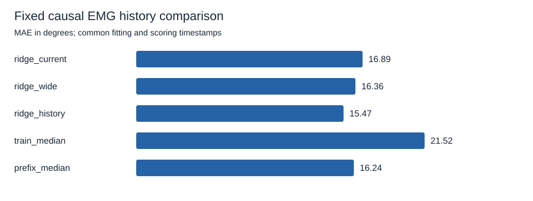
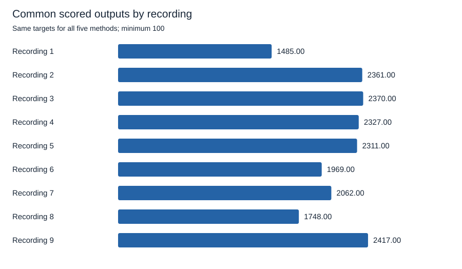

# Recent EMG history reduces average error, with uneven gains across recordings

The fixed five-window history decoder scores **15.474 degrees** macro angular MAE, compared with **16.895 degrees** for current-window ridge, **16.362 degrees** for wide-window ridge, and **16.244 degrees** for prefix median. All nine folds are supported. The primary history-minus-current difference is **-1.420 degrees**, with eight improved folds, no ties, and one worsened fold.

History also has lower aggregate error than the wider single window and prefix median. The benefit is uneven: prefix median still wins in five of nine recordings. These are exploratory offline results from one already inspected person/session. They establish neither population-level improvement nor live virtual-hand control.

## Freeze representations and comparisons before fitting

The maintainer approved [spec 005](../../specs/005-causal-history-decoder.md) on October 15, 2026. The [numeric protocol](../../research/emg2pose/history-v1.json) was committed in `b4bc886` before real-data fitting or coverage analysis. No representation, alpha, prefix, boundary, metric, or minimum count changed after results were seen.

Each fold holds out one original custom-pilot training recording and fits on the other eight. Only recordings 1-9 are opened, verified, fitted, or scored. All models and training median use identical eligible fitting rows. Prefix median receives only eligible held-out reference angles strictly before 10 seconds. It has additional label information unavailable to the uncalibrated decoders. This study provides no hardware-free method to obtain those labels live.

All recordings originate in the full dataset's validation partition. The custom pilot's validation and test files remain excluded. The data and previous outcomes were already inspected, so this is neither an official emg2pose benchmark nor a blind test or preregistration. See the [dataset card](../datasets/emg2pose.md) for provenance, attribution, and noncommercial terms.

At source endpoint `e`, features are:

| Representation | Raw EMG samples, inclusive | Features | Effective alpha |
| --- | --- | ---: | ---: |
| Current window | `e-399` through `e` | 16 | 10 |
| Wide window | `e-1199` through `e` | 16 | 10 |
| Five-window history | Five 400-sample windows ending at `e`, `e-200`, `e-400`, `e-600`, and `e-800`, newest first | 80 | 50 |

Each window produces 16 log1p RMS features. The wide window is computed directly from raw EMG, rather than by averaging log features. The five windows have nominal ages 0, 100, 200, 300, and 400 ms and together span 600 ms. All inputs are past or current. There is no interpolation, padding, output smoothing, target-time shift, pose feedback, intercept calibration, or future input.

All methods require finite inputs and valid timestamp steps throughout the complete 1,200-sample span. Endpoints are `1199 + 40*k`, preserving the original grid phase after removing its first 20 rows. Only the current target reference determines label validity. Historic reference gaps do not remove a valid input history.

Feature standardization uses only the other eight recordings. Constant columns retain unit scale. History's effective alpha 50 on the unscaled standardized stack is equivalent to dividing that stack by `sqrt(5)` before alpha-10 fitting. A duplicate-current test verifies that five copies of the same features reproduce current-window ridge predictions. Duplicating features alone therefore cannot weaken the regularization. History still has more fitted parameters, so the comparison does not isolate temporal order from model capacity.

## Compare five fixed methods on identical targets

| Method | Macro MAE, degrees | Macro RMSE, degrees |
| --- | ---: | ---: |
| Current-window ridge | 16.895 | 23.048 |
| Wide-window ridge | 16.362 | 22.316 |
| Five-window history ridge | 15.474 | 21.149 |
| Training-median pose | 21.522 | 30.177 |
| Prefix-median pose | 16.244 | 25.585 |

MAE averages scored timestamps and 20 joints within each fold, then weights supported folds equally. Macro RMSE is the square root of mean fold MSE. Computation uses radians, converted to degrees for display. [summary.json](../../research/emg2pose/history-v1/summary.json) also reports per-joint metrics, sample-weighted MAE, model settings, and integrity digests.

| History ridge minus comparison | Macro MAE difference, degrees | Improved / tied / worsened folds |
| --- | ---: | ---: |
| Current-window ridge, primary | -1.420 | 8 / 0 / 1 |
| Wide-window ridge, secondary | -0.888 | 7 / 0 / 2 |
| Prefix median, secondary | -0.770 | 4 / 0 / 5 |

Negative means history ridge has lower error. Ties use the fixed 1e-12-radian tolerance. The primary comparator and metric remain unchanged even when another comparison has a different fold count. No winning model is selected for deployment, and no significance test is reported.

## Retain every fold and exclusion

| Held-out recording | Prefix labels | Scored outputs | Current MAE, degrees | Wide MAE, degrees | History MAE, degrees | Prefix median MAE, degrees |
| --- | ---: | ---: | ---: | ---: | ---: | ---: |
| 1 | 471 | 1,485 | 22.638 | 21.140 | 19.735 | 31.047 |
| 2 | 332 | 2,361 | 18.379 | 17.597 | 16.436 | 25.237 |
| 3 | 431 | 2,370 | 17.197 | 17.051 | 16.219 | 19.754 |
| 4 | 471 | 2,327 | 14.369 | 13.848 | 12.231 | 11.560 |
| 5 | 471 | 2,311 | 15.023 | 14.525 | 11.781 | 6.969 |
| 6 | 469 | 1,969 | 14.932 | 13.990 | 14.959 | 8.341 |
| 7 | 432 | 2,062 | 15.938 | 15.277 | 15.282 | 10.901 |
| 8 | 435 | 1,748 | 15.164 | 15.417 | 14.827 | 14.175 |
| 9 | 399 | 2,417 | 18.414 | 18.413 | 17.798 | 18.214 |

Recording 6 has slightly higher history error than current-window error. Wide-window ridge wins against history in recordings 6 and 7. Prefix median wins recordings 4-8, while history wins recordings 1-3 and 9. Larger gains in some recordings explain why the aggregate prefix-median comparison favors history despite five individual losses. Every recording remains in the report and aggregate.

The first 10 seconds provide 3,911 eligible prefix outputs across the nine folds. The 600 ms embargo excludes every candidate outside the prefix that fails the scored-history boundary. Scoring requires endpoint elapsed time at least 10.6 seconds and the entire 1,200-sample history beginning at or after 10.0 seconds.

| Region after common warm-up | Candidates | Invalid input | Invalid reference | Eligible outputs |
| --- | ---: | ---: | ---: | ---: |
| Prefix | 4,239 | 0 | 328 | 3,911 |
| Embargo, excluded | 270 | 0 | 4 | 266 |
| Scoring | 22,410 | 0 | 3,360 | 19,050 |

Every supported fold needs at least 25 valid prefix labels and 100 scored outputs. Input and reference exclusions are counted separately, with reference exclusions conditional on valid inputs. Reference validity follows the upstream failure heuristic; it is not a rest detector or a clinical quality label.

The 600 ms common span changes fitting eligibility, prefix labels, warm-up, and scored targets relative to earlier reports. Current and wide baselines are refitted here, rather than copied from earlier studies. Differences against the [alignment audit](temporal-alignment-v1.md) or [calibration study](limited-label-calibration-v1.md) cannot measure the isolated effect of history.

## Verify behavior and reproduce the command

The initial behavior tests failed with `NotImplementedError: Common 1200-sample causal representations not implemented` and `invalid choice: 'history'`. The implemented command passes all 62 behavior tests. The 12 history tests cover direct raw-window arithmetic, inclusive endpoints, tap order, original grid phase, complete-span input validity, historic-label independence, normalized duplicate equivalence, support boundaries, paired comparisons, and null unsupported results.

A synthetic target dependent on past EMG demonstrates a possible history benefit. Constant targets produce no fabricated benefit, and a separate fixture permits history to lose. Future input and label changes leave earlier predictions and their required histories unchanged. Held-out changes cannot alter that fold's fits. Later label changes can change errors while preserving the fitted models, prefix constant, masks, and predictions when validity is preserved.

End-to-end tests succeed with only nine synthetic training files and reproduce scientific outputs when corrupt validation and test files are added. Empty fitting data fail even when target folds would be unsupported. Missing files, corrupt bytes, invalid timestamps, option misuse, and existing output directories fail explicitly. An all-unsupported study retains reasons and null aggregates.

The 12 history tests pass in five consecutive complete suite runs. Ruff lint and formatting and source and wheel builds pass. Both published SVG plots were inspected visually. An installed wheel launched from a temporary directory outside the checkout reproduces the exact scientific fingerprint with explicit absolute protocol paths. See [wheel-smoke.json](../../research/emg2pose/history-v1/wheel-smoke.json).

Independent direct raw-window calculations and augmented least squares verify all nine folds and 1,800 per-joint MAE and MSE entries. Grid, full-span validity, partition counts, scoring masks, and both medians match exactly. Maximum independent differences are 9.48e-13 radians for MAE, 1.002e-12 radians squared for MSE, and 1.21e-13 radians for the primary comparison.

One MSE entry exceeds an initial 1e-12 verification probe. Component checks attribute the difference mainly to direct versus cumulative feature summation, rather than pairing or regularization. With identical production features, the independent solver agrees with published metrics within 2.58e-14. The [independent evidence](../../research/emg2pose/history-v1/independent-check.json) preserves the initial discrepancy and its diagnosis, and records a 1e-10 absolute tolerance for numerical agreement. This arithmetic tolerance does not change the study's settings, metrics, or 1e-12-radian fold-tie rule.

Five complete real-data processes reproduce identical scientific outputs, including fit, prefix, mask, and per-method prediction digests. Median full-process wall time is **0.920 seconds**, range **0.912-0.947 seconds**, with peak process memory approximately **288.4 MiB**. The Windows environment uses Python 3.12.14, NumPy 2.3.5, h5py 3.14.0, and two numerical-library threads. [repeatability.json](../../research/emg2pose/history-v1/repeatability.json) separates subprocess timing from internal runner timing and records all repeats and resource measurements.

A separate profiler run, excluded from timing summaries, identifies feature construction and repeated model fitting as the largest analysis work. File loading, checksum verification, imports, and interpreter startup also contribute. The desktop is shared, with approximately 19 percent processor load observed before the runs. These are execution checks, not a speedup or physiological-latency measurement.

Follow the [reproduction guide](../reproduce-pilot.md) for a fresh run. Previous scientific artifacts remain unchanged. Published files contain only code, configuration, public identifiers and hashes, aggregate metrics, and plots. No new data, hardware, dependency, GPU, or paid service is required.

## Limit the conclusion to the tested representation

The predeclared history representation reduces aggregate MAE against all three declared comparison methods on these recordings. The benefit is not uniform, and the competitive prefix baseline remains an essential comparison. The result supports further investigation of temporal features without establishing an optimal history length or a biological mechanism.

Folds share training recordings, adjacent outputs are temporally correlated, and the data cover one already inspected session. More fitted parameters remain part of the comparison. No population confidence interval, significance claim, new-person result, stationary intention readout, live control, subjective perception, or full-dive capability follows. A different model, cohort, or task requires another bounded question and approved protocol.
