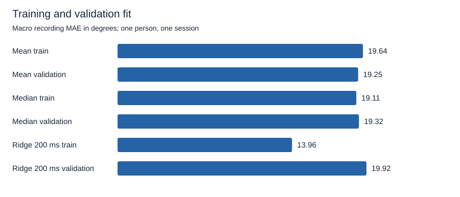
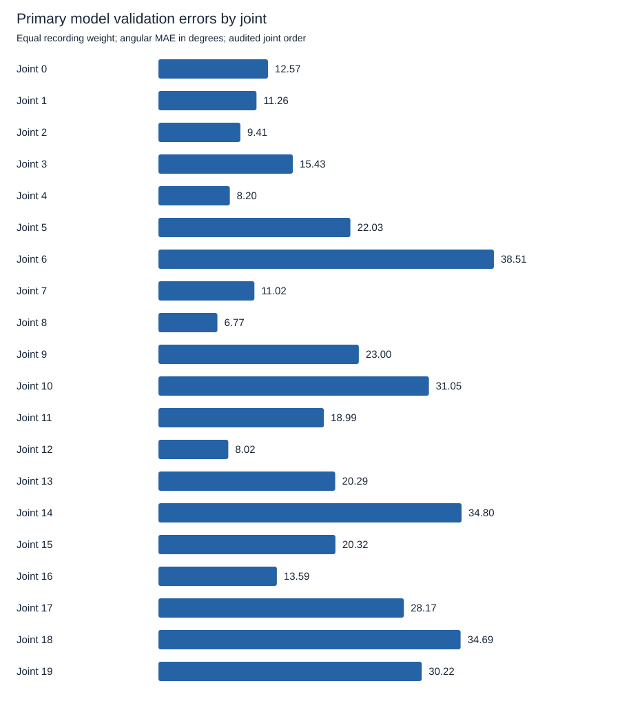
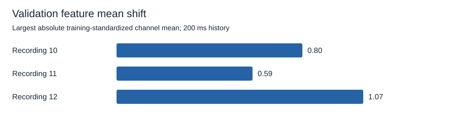

# The ridge decoder fits training tasks but loses its advantage on validation

The diagnostic study supports a task-transfer problem in this small pilot, while leaving its cause unresolved. The primary RMS ridge model improves training macro MAE from 19.106 degrees for train-set median pose to 13.961 degrees. On validation recordings, it scores 19.916 degrees, worse than both train-only constants. Independent solvers agree, and neither rare range violations nor gross feature-mean shifts explain the entire pattern.

This is exploratory analysis of one person's session, completed October 14, 2026, local time. Only nine training and three validation recordings were opened. The three v1 test recordings were excluded. Their previously published outcomes are already known, so this is not a new blind evaluation or an independent replication.

The [approved specification](../../specs/002-decoder-failure-diagnostics.md) fixes the diagnostics. The [original v1 protocol](../../research/emg2pose/pilot-v1.json) and [published results](emg2pose-pilot-v1.md) remain unchanged. No replacement model or new calibration was selected.

## Training improvement does not survive the validation tasks

All scores use the original eligible timestamps, common 400-sample warm-up, 50 Hz output cadence, and equal recording weights. Fitting and feature standardization use training data only. MAE is computed in radians and converted to degrees. Macro RMSE is the square root of the mean per-recording MSE, not the mean of recording RMSEs.

| Method | Training macro MAE, degrees | Validation macro MAE, degrees | Training macro RMSE, degrees | Validation macro RMSE, degrees |
| --- | ---: | ---: | ---: | ---: |
| Train mean pose | 19.635 | 19.251 | 25.935 | 25.061 |
| Train median pose | 19.106 | 19.319 | 27.264 | 26.919 |
| RMS ridge, 50 ms, alpha 10 | 15.596 | 20.338 | 21.241 | 27.912 |
| RMS ridge, 100 ms, alpha 10 | 14.948 | 20.360 | 20.449 | 28.188 |
| Primary RMS ridge, 200 ms, alpha 10 | 13.961 | 19.916 | 19.202 | 27.808 |

The longer history improves training fit. Its validation result does not beat constant pose. Ridge minimizes squared error, whereas the original primary metric is MAE. That objective mismatch matters when comparing methods, but it does not explain away this result: the ridge model also loses to the mean-pose baseline on validation RMSE.

Within the fixed 200 ms history, validation MAE changes from 19.925 to 19.916 degrees as alpha increases from 0.1 to 10. This narrow grid has little effect. It does not show that stronger regularization outside the declared grid would fail. All nine training/validation configurations and per-joint errors are retained in [summary.json](../../research/emg2pose/diagnostics-v1/summary.json).

Training has 23,390 scored outputs from 27,099 candidates after warm-up. Validation has 7,569 from 8,755. There are no invalid input histories in these records; excluded outputs have invalid reference poses under the upstream heuristic. Overlapping windows are not independent biological observations.

## Recording-specific bias is substantial but does not establish a cause

The three validation stages differ. The primary model beats the train-median baseline on recordings 10 and 11, then loses substantially on recording 12. Equal weighting prevents the pooled result from hiding that difference.

| Validation recording | Stage | Train-median MAE, degrees | Primary ridge MAE, degrees | Own-record median MAE, degrees | Squared residual mean as share of ridge MSE |
| --- | --- | ---: | ---: | ---: | ---: |
| 10 | HandClawGraspFlicks | 20.324 | 16.814 | 14.964 | 31.9% |
| 11 | ShakaVulcanPeace | 20.179 | 19.078 | 17.523 | 13.2% |
| 12 | HookEmHornsOKScissors | 17.453 | 23.856 | 14.370 | 52.8% |

The own-record median uses all scored labels in that recording. It is a descriptive lower bound for constant predictors with privileged label access, not a deployable baseline or a calibration result. It is excluded from fitting and model selection.

For each recording and joint, residual MSE equals squared residual mean plus population residual variance. The implementation verifies that identity. The final column averages those squared terms across joints before taking their ratio. It describes how much error is associated with a consistent offset; it does not partition causal mechanisms.

Recording 12 has large positive mean residuals in several finger-flexion joints. For example, joint 6, index PIP flexion, has approximately +40.84 degrees mean residual, and joint 18, pinky PIP flexion, approximately +41.93 degrees. Positive means prediction exceeds reference. The audited joint order is linked in the [dataset card](../datasets/emg2pose.md).

This pattern is consistent with a mismatch between the mapping learned from the training stages and some held-out poses. It does not identify whether that mismatch arises from feature insufficiency, model form, movement history, task composition, or another factor. Training error also remains substantial, so this is not a claim that training poses are decoded perfectly.

## Simple feature statistics show no wholesale mean shift

Feature statistics use training-only means, standard deviations, and percentiles. For the primary history, the largest absolute training-standardized channel mean in each validation recording is:

| Recording | Largest absolute channel mean in training standard deviations | Fraction of channel-output values with absolute z greater than 3 | Fraction outside training 1st/99th percentiles |
| --- | ---: | ---: | ---: |
| 10 | 0.802 | 1.368% | 3.043% |
| 11 | 0.587 | 1.151% | 5.695% |
| 12 | 1.065 | 0.183% | 1.052% |

Training recordings themselves have largest absolute channel means ranging from approximately 0.377 to 1.479 training standard deviations. Recording 12 has the worst primary validation error despite relatively few extreme feature values by these summaries. These checks do not support a simple explanation in which that recording fails solely because its EMG amplitudes are far outside training support.

Univariate means and thresholds cannot detect every multichannel or time-dependent shift. In particular, similar feature marginals can coexist with different pose-to-feature relationships. No normality assumption, population significance test, or physiological sensor-drift claim follows from these thresholds.

## Range violations are rare and cannot account for all error

The table groups individual predicted joint-angle values by whether they fall outside the training target minimum and maximum for that joint. These are empirical training ranges, not physiological limits. No clipping is applied.

| Validation recording | Predicted angle values outside training range | Reference angle values outside training range | MAE outside prediction range, degrees | MAE inside prediction range, degrees |
| --- | ---: | ---: | ---: | ---: |
| 10 | 0.503% | 0.0301% | 44.007 | 16.677 |
| 11 | 1.169% | 0.0020% | 52.888 | 18.678 |
| 12 | 0.0145% | 0% | 45.535 | 23.853 |

Outside-range predictions have larger errors, but most error occurs while predictions remain inside the broad training ranges. Recording 12 is especially clear: almost every prediction is in range, yet its in-range error remains large. This study does not test clipping as a correction. Central-percentile diagnostics and empty-group handling are included in the aggregate artifact.

## Numerical checks agree with the original implementation

The standardized training feature matrices have full rank 16. Their condition numbers are approximately 21.05, 20.45, and 19.96 for the 50, 100, and 200 ms histories. The primary regularized system condition number is approximately 391.65.

An augmented least-squares solution independently reproduces predictions from the existing normal-equation ridge solver on both training and validation inputs. The largest difference across all nine configurations is about 4.82e-14 radians, well below the declared tolerance. All nine validation macro MAEs reproduce the frozen v1 validation results within 1e-12 numerical tolerance.

These checks argue against the numerical solve being responsible for the observed errors. They do not validate the biological meaning of the labels, the sufficiency of RMS features, or the linear model assumptions.

## Reproduce the diagnostics

Follow [the reproduction guide](../reproduce-pilot.md). The new command reads only training and validation HDF5 files. Behavior tests demonstrate success when all test files are absent and unchanged scientific output when unusable test files are added. Changing validation inputs and labels leaves training references and training scores unchanged.

The 26-test suite includes known-answer residual decomposition, group weighting, target dispersion, feature shifts, range masks, singular features, empty groups, and independent solver agreement. Initial diagnostic tests failed with `NotImplementedError: Residual diagnostics not implemented` and an unsupported `diagnose` command before implementation.

Five complete unprofiled runs reproduce identical aggregate scientific output. Full-process wall time has a median of 1.757 seconds and a range of 1.657-2.257 seconds, including interpreter startup, imports, analysis, output generation, and process exit. Peak process memory is approximately 345 MiB, with numerical-library thread limits of two. These measurements are from the existing Windows/Python 3.12.14/NumPy 2.3.5/h5py 3.14.0 environment.

[repeatability.json](../../research/emg2pose/diagnostics-v1/repeatability.json) distinguishes full subprocess wall time from internal runner time, which excludes startup and imports. A separate profiler run identified full-recording feature construction and cumulative sums as the largest analysis work. The desktop was not reserved for benchmarking. Resource checks demonstrate bounded execution, not a speedup or real-time guarantee.

Published artifacts contain only configuration, file identifiers and checksums, aggregate statistics, and plots. Source recordings and per-sample poses, residuals, and predictions are excluded. Source attribution and noncommercial data terms are in the [dataset card](../datasets/emg2pose.md). No hardware, GPU, new download, paid service, or human experiment was required.

## Test one bounded follow-on hypothesis

The next hypothesis is that a fixed, small labeled prefix can correct some recording-specific pose bias. A separate exploratory protocol could leave out one training recording at a time, calibrate an intercept using only a predetermined prefix, and score later samples after a temporal gap. Constant-pose controls must receive the same label allowance. This diagnostic study does not perform that calibration or show that it will help.

Such a study can test whether limited offset adaptation explains useful error reduction. Failure would motivate a different representation or model question. It would remain software-only and would disclose that these public recordings and the original v1 outcomes have already been examined.
