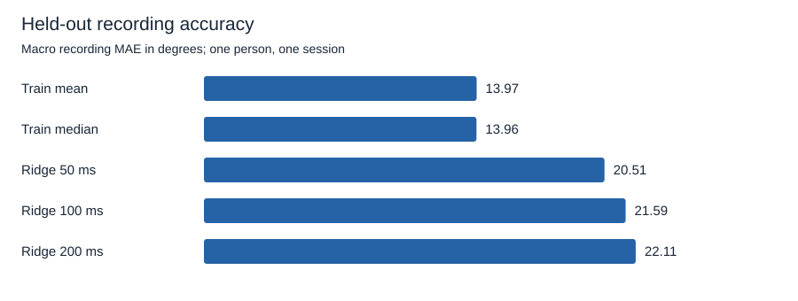
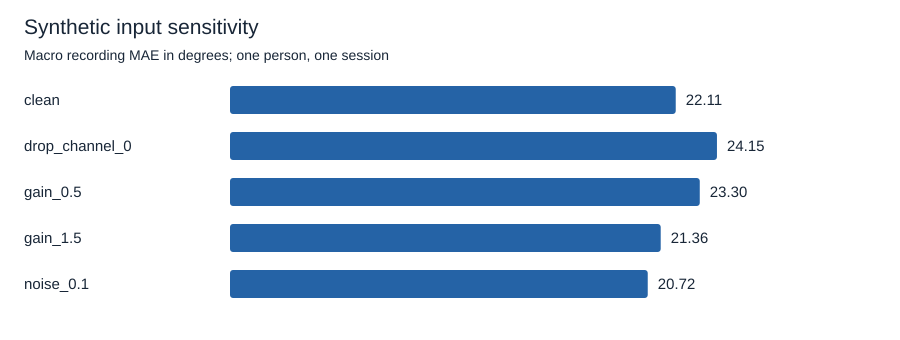
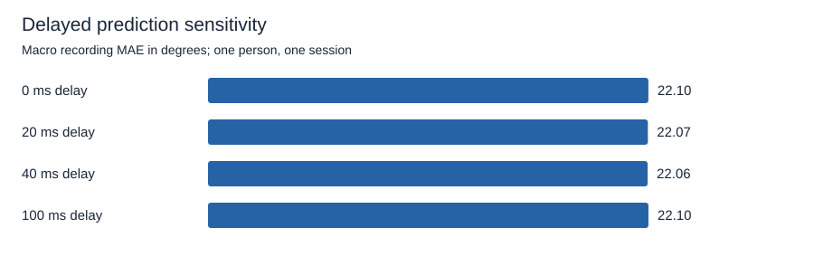

# A simple causal EMG decoder fails to beat constant pose

Experiment completed October 14, 2026, local time. The validation-selected ridge decoder has a test macro mean absolute error of **22.110 degrees**, compared with **13.957 degrees** for the train-set median pose. All three declared EMG histories perform worse than both constant-pose baselines. This first pilot establishes a reproducible negative result, not useful hand control.

The experiment uses one person, one recording session, 16 EMG channels, and 20 reference joint angles. It cannot establish new-person or new-session performance, physiological intention detection, live control, perception, or full-dive capability. No specialized hardware, GPU, paid service, new recordings, or human experiment was involved.

## Freeze the question and evaluation

The [approved protocol](../../research/emg2pose/pilot-v1.json) assigns left-hand recordings 1-9 to training, 10-12 to validation, and 13-15 to testing. Right-hand recordings are unused. Every file originates in the full dataset's validation partition. This is a custom within-session comparison, not the official emg2pose benchmark. The source commit, data terms, schemas, hashes, and acquisition limits are documented in the [dataset audit](../datasets/emg2pose.md).

At each output index, take a trailing 50, 100, or 200 ms history of EMG. Compute 16 per-channel `log1p(RMS)` values and apply training-only standardization. Fit ridge regression to all 20 joint angles with an unpenalized intercept. The objective is summed squared training error plus alpha times squared coefficients. Training samples have equal weight. A zero-variance feature uses a scale of one. Train-only mean and median poses use the same eligible training output timestamps.

All methods share a 400-sample warm-up and a 40-sample output stride, nominally 50 Hz. Outputs never cross recording boundaries. A common history containing nonfinite input or an out-of-range timestamp step is excluded. Steps must lie between 0.25 and 0.75 ms. A target must be finite and must not have all 20 angles close to zero under NumPy defaults. That reference-failure heuristic is not a rest label. Invalid references affect scoring, not feature construction.

The primary metric averages angular MAE across joints and timestamps within each recording, then weights the three test recordings equally. Values are computed in radians and converted to degrees. The metric does not measure fingertip position, grasp success, subjective plausibility, or independent information capacity. No initial reference pose, label-derived time shift, or test-label calibration is supplied.

Choose history and alpha from validation macro MAE only. Candidates are histories of 50, 100, and 200 ms with alphas 0.1, 1, and 10. Ties follow manifest order. Validation selected 200 ms and alpha 10, with validation error 19.916 degrees. Each history's reported test result uses its validation-selected alpha. Reporting the three frozen comparisons does not authorize choosing a new model from their test errors.

The protocol followed data-quality inspection and maintainer approval, before model fitting. It is not a preregistration or a blind test-set acquisition. The test results are now known. Future model development must state that exposure.

## Compare held-out errors

| Method | History | Alpha | Test macro MAE, rad | Test macro MAE, degrees |
| --- | ---: | ---: | ---: | ---: |
| Train mean pose | None | None | 0.243737 | 13.965 |
| Train median pose | None | None | 0.243593 | 13.957 |
| RMS ridge | 50 ms | 10 | 0.357976 | 20.510 |
| RMS ridge | 100 ms | 10 | 0.376886 | 21.594 |
| Validation-selected RMS ridge | 200 ms | 10 | 0.385894 | 22.110 |

| Test recording | Stage | Scored outputs | Mean pose, degrees | Median pose, degrees | Selected ridge, degrees |
| --- | --- | ---: | ---: | ---: | ---: |
| 13 | TwoHandedFreeStyle | 9,894 | 15.822 | 15.707 | 23.070 |
| 14 | OneHandedFreeStyle | 2,266 | 17.074 | 15.407 | 24.604 |
| 15 | unconstrained | 1,391 | 9.000 | 10.756 | 18.656 |

The selected decoder loses on every test recording. The shorter history has the lowest ridge test error, but validation selected the longer history. That mismatch is part of the result. It does not justify revising selection after seeing the test data.

The training recordings cover approximately 543.7 seconds, about nine minutes. They are task-separated from the held-out freestyle recordings but remain from the same person and session. A constant prediction can be competitive when target poses cluster around a common posture. This study does not isolate whether the decoder's failure comes from insufficient features, model form, task differences, or another distribution difference. It provides no evidence that EMG contains no useful pose information.

## Account for excluded outputs

| Partition | Candidate outputs after common warm-up | Invalid input | Invalid reference with valid input | Scored outputs |
| --- | ---: | ---: | ---: | ---: |
| Training | 27,099 | 0 | 3,709 | 23,390 |
| Validation | 8,755 | 0 | 1,186 | 7,569 |
| Test | 16,738 | 0 | 3,187 | 13,551 |

Test coverage is 80.96% of scheduled outputs after warm-up. Coverage is the same for every history and synthetic corruption. These counts are at the 50 Hz evaluation cadence; they differ from the audit's counts at the source sampling cadence. The longest test recording contributes most timestamps but has the same primary-metric weight as each shorter recording. Per-joint, per-recording, and sample-weighted results are in [summary.json](../../research/emg2pose/pilot-v1/summary.json).

## Probe synthetic sensitivity

| Selected decoder condition | Test macro MAE, degrees |
| --- | ---: |
| Clean EMG | 22.110 |
| Channel 0 replaced with zero | 24.155 |
| Global gain 0.5 | 23.302 |
| Global gain 1.5 | 21.365 |
| Gaussian noise, standard deviation 0.1 times training channel RMS | 20.721 |

Conditions modify released EMG before features. Noise uses seed 0, restarted for each recording, and per-channel RMS estimated only from raw finite training EMG. Models are not refit. All conditions use the same scored timestamps. Neither electrode replacement nor biological drift is measured.

Some perturbations improve error. The clean decoder is already poor, and a small artificial change can shift predictions closer to the reference. This result does not establish beneficial noise, robustness, or a physiological mechanism. No perturbation makes the selected decoder outperform the constant-pose baselines.

Delayed-output diagnostics compare predictions from 0, 20, 40, or 100 ms earlier with current targets. All delays share 13,536 eligible target timestamps after a common five-output delay warm-up. Errors are respectively 22.098, 22.072, 22.060, and 22.101 degrees. These small changes are descriptive, without a population-level uncertainty claim. They do not establish that delay is harmless in human control.

## Measure computation without claiming physiological latency

Five complete unprofiled runs produced identical selected settings, model hashes, and accuracy. Each run also measured five warm timing passes over all 13,551 eligible test outputs. That is 25 timing passes, not 25 independent biological experiments.

| Measurement | Observed result |
| --- | --- |
| Complete command, including generated files | Median 16.427 s, range 14.207-18.839 s across five final runs |
| Peak process memory | Approximately 664-665 MiB across five runs |
| Feature extraction, median of pass p50 values | 0.0099 ms per output |
| Ridge prediction, median of pass p50 values | 0.0027 ms per output |
| Combined features and prediction, median of pass p50 values | 0.0127 ms per output |
| Combined per-pass p99 range | 0.4678-2.6831 ms per output |

The recorded environment is Windows AMD64, Python 3.12.14, NumPy 2.3.5, h5py 3.14.0, eight logical CPUs, and numerical-library thread limits of two. The desktop was not reserved for benchmarking. Host scheduling and background activity can affect the timing distributions. No hard real-time guarantee or comparison against another runtime is claimed.

The timed operation copies one complete trailing window, computes RMS and its logarithm, standardizes features, and evaluates ridge predictions. It excludes HDF5 reads, validity determination, corruption generation, output writing, replay scheduling, and wall-clock waiting. Predictions are consumed in a checksum. The whole-command measurement includes loading, hash checks, fitting, validation, scoring, sensitivity, timing passes, and report writing.

A separate profiler run, excluded from timing summaries, identified array cumulative sums and repeated feature/prediction loops as the main work. Ridge fitting was not the primary runtime cost. All runs finished under the 15-minute cap. [repeatability.json](../../research/emg2pose/pilot-v1/repeatability.json) retains each run's resources and timing passes.

A 200 ms history supplies past context. It is not automatically 200 ms of added delay. Outputs have zero future lookahead and a nominal 20 ms update period after the 400-sample warm-up. The original acquisition and reference-label pipeline has not been certified causal. Offline execution time cannot establish sensor-to-percept latency.

## Verify and reproduce

The tests were written before their corresponding implementation. Initial checks failed with `NotImplementedError: Causal trailing-window features not implemented` and `NotImplementedError: CPU benchmark command not implemented`. The completed 16-test behavior suite checks future invariance, alignment, gap recovery, invalid references, train-only statistics, recording weighting, deterministic corruptions, protocol and file boundaries, real synthetic HDF5 command execution, and refusal to overwrite results. Changing all test labels leaves the fitted model hash and selected settings unchanged.

A final packaging check found that hashing raw protocol text depended on line endings. A regression test first failed because equivalent JSON produced different fingerprints. The runner now hashes sorted, compact parsed JSON as UTF-8. The final five published runs use that fix. This metadata correction did not change the frozen numeric protocol, fitted model, or scientific results. Source recording hashes continue to identify exact bytes.

An independent direct-window computation checked every 73rd eligible output across all 15 recordings. The largest feature difference from cumulative-sum extraction was 3.57e-10. An augmented least-squares solution agreed with the ridge coefficients at relative tolerance 1e-8 and absolute tolerance 1e-10, and independently reproduced the three selected-model test errors. These checks did not change the frozen experiment.

Follow [the reproduction guide](../reproduce-pilot.md). Published artifacts contain aggregate errors, protocol details, checksums, plots, and environment summaries. They contain no source recordings or per-sample reference poses and predictions. Dataset attribution and noncommercial use terms remain in the [dataset card](../datasets/emg2pose.md). This project has not selected its own reuse license.

## Follow the observed failure

The next bounded question is why a 16-feature linear decoder loses to constant pose. Use training and validation recordings to inspect target-pose dispersion, feature scale shifts, residuals by joint and stage, and conditioning. Any new features or temporal model need a new declared protocol and an honest statement that this pilot's test data have been seen. Improve the experiment's explanatory power before enlarging the model or dataset. Hardware access is not a dependency for that work.
