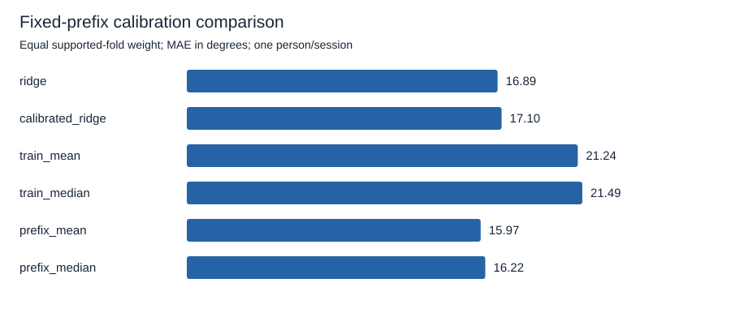
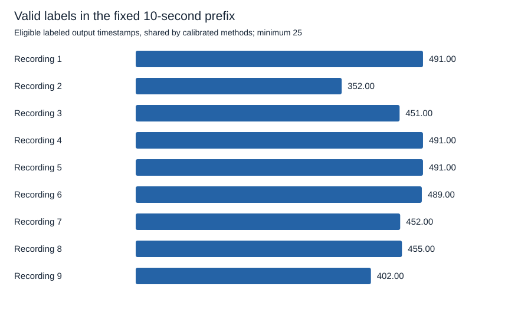

# Fixed-prefix calibration does not beat the equally informed constant control

The approved 10-second intercept-calibration study does not improve the average result. Calibrated ridge scores **17.103 degrees** macro angular MAE, compared with **16.886 degrees** for uncalibrated ridge and **16.217 degrees** for the primary matched-label prefix-median control. Calibration helps five of nine folds and harms four. All nine folds are supported; none is removed from the result.

This exploratory experiment uses only original training recordings 1-9 from one person and session. Original validation and test recordings are excluded from loading, fitting, calibration, and scoring. The data and earlier v1 outcomes have already been inspected. This is neither a new blind test nor a preregistration. It was completed October 14, 2026, local time, as the final requested study for the evening.

Here, original training means the custom v1 pilot's nine training files. All starter files originate in the full dataset's validation partition. This is not an official emg2pose benchmark. The [dataset audit](../datasets/emg2pose.md) records that distinction and the source provenance.

## Fix the protocol before real-data fitting

The maintainer approved [spec 003](../../specs/003-limited-label-calibration.md). The [numeric protocol](../../research/emg2pose/calibration-v1.json) was committed in `bc69052` before real-data fitting. Its prefix, embargo, model, folds, label-count minimum, controls, and metrics were not changed after results were seen.

Each fold holds out one original training recording and fits on the other eight. Ridge uses the existing 400-sample nominal 200 ms log1p RMS features, train-only standardization, alpha 10, and an unpenalized intercept. Training-only mean and median poses use the same eligible fitting outputs. Fitting uses the other recordings regardless of their place in session chronology; this is an offline cross-validation experiment, not a prospective deployment simulation.

Elapsed time starts at the held-out recording's first source timestamp. Eligible reference labels strictly before 10.0 seconds form the calibration prefix. A fixed offset is the mean of prefix reference minus original model prediction, computed separately for each joint. Later calibrated predictions equal the original model output plus this offset. Coefficients and input standardization remain unchanged.

Scoring requires elapsed time at least 10.2 seconds and a complete trailing history beginning at or after 10.0 seconds. Prefix and embargo outputs are excluded for all methods. The minimum allowance is 25 valid prefix outputs and one scored output. Unsupported folds would have been reported and excluded from every method's paired aggregate together; no extension or boundary adjustment was permitted. In the actual data, every fold meets the requirement.

Prefix-mean and prefix-median controls receive exactly the same valid labels as calibrated ridge and then hold a constant pose. They use no EMG for prediction. Public motion-capture-derived reference angles supply those labels. An actual system would need a way to obtain equivalent calibration information; this experiment does not provide that capability or assume the maintainer will acquire hardware.

## Compare all six declared methods

| Method | Label access in held-out recording | Macro MAE, degrees | Macro RMSE, degrees |
| --- | --- | ---: | ---: |
| Uncalibrated ridge | None | 16.886 | 23.032 |
| Intercept-calibrated ridge | Fixed prefix | 17.103 | 25.125 |
| Train-mean pose | None | 21.243 | 28.003 |
| Train-median pose | None | 21.490 | 30.130 |
| Prefix-mean pose | Same fixed prefix | 15.967 | 24.459 |
| Prefix-median pose, primary matched-label control | Same fixed prefix | 16.217 | 25.533 |

MAE is averaged across scored timestamps and 20 joints within each fold, then across folds with equal weight. Computation uses radians, converted to degrees for display. Macro RMSE is the square root of mean fold MSE. Per-joint and sample-weighted metrics are in [summary.json](../../research/emg2pose/calibration-v1/summary.json).

The two predeclared paired macro differences are:

- Calibrated ridge minus uncalibrated ridge: **+0.217 degrees**, with five improved, zero tied, and four worsened folds.
- Calibrated ridge minus prefix median: **+0.886 degrees**, with three improved, zero tied, and six worsened folds.

Positive means calibrated ridge has higher error. Ties use the fixed 1e-12-radian tolerance. Prefix median remains the primary equally informed control even though the secondary prefix-mean control has a lower observed macro MAE. No outcome-based comparator selection is applied.

The uncalibrated model beats training-only constants on aggregate, so the results do not imply that EMG contributes no useful signal. They show that this particular intercept adaptation does not outperform its uncalibrated model or the primary label-informed constant on the declared MAE metric. Calibrated ridge has lower RMSE than prefix median but higher MAE; that metric tradeoff does not change the predeclared primary result.

## Keep every fold visible

| Held-out recording | Valid prefix outputs | Scored outputs | Ridge MAE, degrees | Calibrated ridge MAE, degrees | Prefix-median MAE, degrees |
| --- | ---: | ---: | ---: | ---: | ---: |
| 1 | 491 | 1,505 | 22.500 | 37.054 | 30.662 |
| 2 | 352 | 2,381 | 18.391 | 18.511 | 25.393 |
| 3 | 451 | 2,390 | 17.237 | 17.302 | 19.729 |
| 4 | 491 | 2,347 | 14.344 | 12.101 | 11.558 |
| 5 | 491 | 2,331 | 15.022 | 10.209 | 6.911 |
| 6 | 489 | 1,989 | 15.000 | 10.927 | 8.506 |
| 7 | 452 | 2,082 | 15.931 | 13.562 | 10.864 |
| 8 | 455 | 1,764 | 15.184 | 14.057 | 14.197 |
| 9 | 402 | 2,437 | 18.365 | 20.203 | 18.132 |

Recording 1 deteriorates substantially after calibration, offsetting gains in several other recordings. Its prefix has plenty of valid labels, so the minimum-label threshold does not protect against this failure. A fixed early offset need not describe the rest of a recording. This observation is consistent with changing pose composition or model residuals over time, but the study does not isolate a biological or causal mechanism. The difficult fold remains in every aggregate.

There are 4,074 valid prefix output timestamps and 19,226 scored output timestamps across all folds. Each valid timestamp supplies all 20 angle labels. The prefix is fixed at 10 seconds, so missing references change the actual count without changing the time allowance.

| Region after common warm-up | Candidate outputs | Invalid input | Invalid reference | Eligible outputs |
| --- | ---: | ---: | ---: | ---: |
| Calibration prefix | 4,419 | 0 | 345 | 4,074 |
| Embargo, excluded from scoring | 90 | 0 | 0 | 90 |
| Scoring | 22,590 | 0 | 3,364 | 19,226 |

The upstream reference-failure heuristic is not a rest label or a direct clinical quality measure. Eligible output timestamps are nominally 50 Hz and temporally correlated. The nine folds overlap in their training recordings and are not independent biological replicates. No population confidence interval or significance test is reported.

## Verify isolation and reproduce the result

Follow [the reproduction guide](../reproduce-pilot.md). The command verifies only the nine original training files. Tests succeed with original validation/test files absent and reproduce identical scientific output when unusable files for those partitions are added.

Known-answer tests cover prefix and embargo boundaries, nonoverlapping input histories, fixed mean-residual offsets, equally informed constants, paired differences, tie tolerance, unsupported folds, and timestamp errors. Changing all held-out data cannot change that fold's initial fit. Changing later reference labels while preserving valid scored timestamps changes scores but leaves the initial fit, calibration state, and predictions unchanged. An all-unsupported synthetic study publishes null aggregate errors and explicit fold reasons rather than fabricated zero errors.

The initial tests failed with `NotImplementedError: Fixed prefix and embargo partition not implemented` and an unsupported `calibrate` command before implementation. Boundary verification also corrected an arithmetic mistake in the synthetic fixture's expected output count: with the approved cadence, its first scored index is 20,439 and last is 21,999, yielding 40 outputs. The protocol boundary was unchanged.

An independent augmented least-squares fit and direct prefix-offset/constant calculation reproduce all six methods' per-joint MAEs across all nine folds. The maximum discrepancy is approximately 3.55e-15 radians. This check does not reuse the calibration helper's offset or control calculations.

Five complete unprofiled processes reproduce identical scientific outputs, including fit, calibration-state, and prediction fingerprints. Full-process wall time has median **1.077 seconds**, range **1.015-1.186 seconds**, and peak process memory approximately **272 MiB** with two numerical-library threads. The environment is the existing Windows/Python 3.12.14/NumPy 2.3.5/h5py 3.14.0 setup. [repeatability.json](../../research/emg2pose/calibration-v1/repeatability.json) distinguishes subprocess time from internal runner time and records all repeats.

A separate profiler run, excluded from reported resource summaries, identifies feature construction and repeated fold fitting as the main analysis work. Interpreter/module startup also contributes to full-process time. The desktop is not reserved for benchmarking. These measurements verify bounded execution, not speedup or physiological latency.

The original v1 and diagnostic protocols and results remain unchanged. Published files contain only code, configuration, identifiers/checksums, aggregate metrics, integrity digests, and plots. Raw signals, per-sample labels/residuals/predictions, and fitted coefficients are excluded. Source attribution and noncommercial terms remain in the [dataset card](../datasets/emg2pose.md).

## Stop at the declared conclusion

The tested 10-second intercept-calibration approach does not improve aggregate MAE over uncalibrated ridge or the primary equally informed constant. The result does not rule out other calibration methods, representations, durations, or cohorts. Those are separate questions requiring new protocols. No further study is started tonight. This remains software-only research, with no claim of live control, stationary intention decoding, perception, clinical safety, or full-dive capability.
