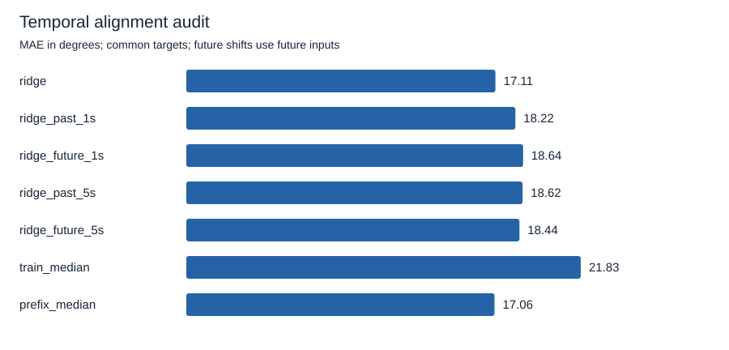
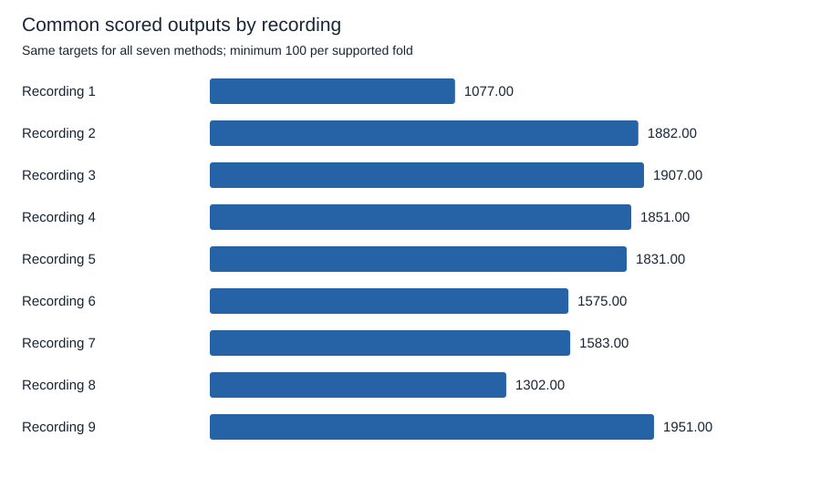

# Correct timing helps fixed ridge, but a prefix constant retains lower MAE

Correctly timed ridge predictions score **17.111 degrees** macro angular MAE, compared with **18.529 degrees** for the mean of the past and future 5-second shift errors. The primary paired difference is **-1.418 degrees**: seven folds improve, none tie, and two worsen. All nine folds are supported. The prefix-median constant retains slightly lower MAE at **17.059 degrees** on exactly the same targets.

The result supports useful temporal alignment for this fixed decoder on these recordings. It does not establish neural latency, a biological mechanism, or live user control. The future-shift controls use future EMG and cannot run causally. The 0.052-degree difference against prefix median is descriptive; no significance claim is made.

## Keep the audit fixed and separate from earlier studies

The maintainer approved [spec 004](../../specs/004-temporal-alignment-audit.md) on October 15, 2026. The [numeric protocol](../../research/emg2pose/alignment-v1.json) was committed in `b62412f` before real-data fitting or coverage analysis. No lag, model, prefix duration, tolerance, or minimum count changed after results were seen.

The nine folds use only original custom-pilot training recordings 1-9. Each fit uses the other eight recordings, regardless of session chronology. Features remain 400-sample trailing log1p RMS, with train-only standardization, ridge alpha 10, and an unpenalized intercept. Predictions receive no intercept calibration or clipping. Both constants use the same scored targets. Training median uses fitting labels; prefix median receives only eligible held-out labels strictly before 10 seconds.

These data and earlier results were already inspected. The recordings cover one person in one session, and all originate in the full dataset's validation partition. This is exploratory analysis, not an official emg2pose benchmark, a blind test, or a preregistration. Original custom validation and test recordings are excluded from verification, loading, fitting, and scoring. See the [dataset card](../datasets/emg2pose.md) for provenance, attribution, and noncommercial terms.

The scoring subset differs from the [calibration study](limited-label-calibration-v1.md). Both 5-second source directions must exist and meet the common eligibility rules. Aligned and constant predictions are recomputed on this subset. Differences between this report and earlier reports cannot be attributed to timing alone.

## Compare every declared method on common targets

The original output grid begins at sample index 399 and advances by 40 samples. At target row `k`, the five ridge sources are `k`, `k - 50`, `k + 50`, `k - 250`, and `k + 250`. Pairing happens before invalid rows are removed. There is no wrapping, cross-recording pairing, interpolation, nearest-valid substitution, or lag search.

| Method | Macro MAE, degrees | Macro RMSE, degrees |
| --- | ---: | ---: |
| Aligned ridge | 17.111 | 23.253 |
| Ridge from 1 second in the past | 18.216 | 25.030 |
| Ridge from 1 second in the future | 18.645 | 25.452 |
| Ridge from 5 seconds in the past | 18.616 | 25.664 |
| Ridge from 5 seconds in the future | 18.442 | 25.260 |
| Training-median pose | 21.834 | 30.610 |
| Prefix-median pose | 17.059 | 26.432 |

MAE averages the scored timestamps and 20 joints within each fold, then weights the nine folds equally. Macro RMSE is the square root of mean fold MSE. Computation uses radians, converted to degrees for display. [summary.json](../../research/emg2pose/alignment-v1/summary.json) contains per-joint metrics and sample-weighted MAE.

The primary comparator averages the two 5-second MAEs within each fold. It does not average prediction vectors. All secondary comparisons remain visible:

| Aligned ridge minus comparison | Macro MAE difference, degrees | Improved / tied / worsened folds |
| --- | ---: | ---: |
| Mean of past and future 5-second errors, primary | -1.418 | 7 / 0 / 2 |
| Past 1-second error | -1.105 | 7 / 0 / 2 |
| Future 1-second error | -1.533 | 8 / 0 / 1 |
| Past 5-second error | -1.505 | 8 / 0 / 1 |
| Future 5-second error | -1.331 | 8 / 0 / 1 |
| Prefix-median error | +0.052 | 4 / 0 / 5 |

Negative means aligned ridge has lower error. Ties use the fixed 1e-12-radian tolerance. The primary comparator remains unchanged even when an individual shift gives a different fold count.

## Keep fold failures and coverage visible

| Held-out recording | Prefix labels | Common targets | Aligned MAE, degrees | Mean 5-second MAEs, degrees | Prefix-median MAE, degrees |
| --- | ---: | ---: | ---: | ---: | ---: |
| 1 | 491 | 1,077 | 24.855 | 23.962 | 35.253 |
| 2 | 352 | 1,882 | 18.054 | 22.205 | 25.731 |
| 3 | 451 | 1,907 | 16.495 | 20.179 | 20.125 |
| 4 | 491 | 1,851 | 14.643 | 16.530 | 12.193 |
| 5 | 491 | 1,831 | 15.455 | 15.373 | 7.148 |
| 6 | 489 | 1,575 | 15.229 | 16.239 | 8.499 |
| 7 | 452 | 1,583 | 15.983 | 16.529 | 11.199 |
| 8 | 455 | 1,302 | 15.381 | 16.320 | 14.473 |
| 9 | 402 | 1,951 | 17.907 | 19.424 | 18.913 |

Recordings 1 and 5 have higher aligned error than their symmetric 5-second comparison. They remain in every aggregate. Prefix median also wins in several recordings despite receiving no EMG for prediction. It receives reference angles from the public dataset, which are additional information unavailable to the uncalibrated decoder. This audit supplies no hardware-free method to obtain those labels live.

The coverage counts are successive intersections, not independent exclusion categories:

| Filtering step | Retained target outputs across nine folds |
| --- | ---: |
| All original grid rows | 27,099 |
| Valid target input and reference | 23,390 |
| Every source index in bounds | 19,327 |
| Every source input history valid | 19,327 |
| Every source after prefix and embargo | 14,959 |
| Every signed shift within duration tolerance | 14,959 |

Every source endpoint must be at least 10.2 seconds after recording start, and its complete trailing history must begin at or after 10.0 seconds. The held-out prefix has 4,074 eligible labeled outputs across all folds. Each supported fold needs at least 25 such outputs and at least 100 common targets. Source reference validity does not filter targets; source inputs and the target reference determine the mask.

| Signed source shift | Actual minimum, seconds | Actual maximum, seconds |
| --- | ---: | ---: |
| Past 1 second | -1.006376 | -0.994346 |
| Future 1 second | 0.994346 | 1.006368 |
| Past 5 seconds | -5.007872 | -4.994056 |
| Future 5 seconds | 4.994056 | 5.007864 |

All retained durations meet the fixed inclusive 10 ms tolerance. Actual timestamp variation makes nominal sample shifts approximate elapsed-time shifts. The audit measures neither a sensory nor a neural transmission delay.

## Verify the arithmetic and complete command

The initial behavior tests failed with `NotImplementedError: Common original-grid temporal pairing not implemented` and `invalid choice: 'align'`. A review then caught an empty-fitting-data failure path. Its new end-to-end test first failed with `AssertionError: 0 == 0` because the command incorrectly returned success. Fitting support is now checked before a target fold can return unsupported. No scientific setting changed.

Known-answer tests verify shift signs, original-grid pairing, common masks, inclusive tolerance boundaries, prefix and embargo isolation, exactly 25 prefix labels, exactly 100 common targets, unsupported reasons, and mean-of-errors arithmetic. Synthetic aligned tracking wins against shifted controls; constant predictions tie; another fixture deliberately makes a shifted prediction better. Tests do not assume that aligned predictions must win.

The real command succeeds with only nine synthetic training files present and gives identical scientific results with corrupt validation and test files added. Later held-out labels can change scores while leaving that fold's fit, prefix constant, target mask, and predictions unchanged when reference validity is preserved. Missing files, checksum failures, bad timestamps, empty fits, option misuse, and output overwrites fail explicitly. Unsupported studies preserve reasons and null aggregates.

All 50 behavior tests pass, and the 13 new alignment tests pass in five consecutive complete suite runs. Lint and formatting checks and source and wheel builds pass. Both published SVG plots were inspected visually. An installed wheel launched from a temporary directory outside the checkout reproduces the exact scientific fingerprint with explicit absolute protocol paths. See [wheel-smoke.json](../../research/emg2pose/alignment-v1/wheel-smoke.json).

An independent direct-index calculation and augmented least-squares solver verify every supported fold, sharing only common feature extraction. Target counts, mask hashes, and prefix-median hashes match exactly. All 2,520 per-joint MAE and MSE comparisons agree within 1e-12. Maximum discrepancies are approximately 1.04e-14 radians for MAE and 1.39e-14 radians squared for MSE. The maximum primary-difference discrepancy is 3.89e-16 radians. See [independent-check.json](../../research/emg2pose/alignment-v1/independent-check.json).

Five complete processes reproduce identical scientific metrics and integrity digests. Median full-process wall time is **0.624 seconds**, range **0.614-0.686 seconds**, with peak process memory approximately **272.3 MiB**. These Windows measurements use Python 3.12.14, NumPy 2.3.5, h5py 3.14.0, and two numerical-library threads. [repeatability.json](../../research/emg2pose/alignment-v1/repeatability.json) separates full-process time from internal runner time and records errors, environment, and every repeat.

A separate profiler run is excluded from those timing summaries. Feature construction, file loading and checksum verification, and repeated fold fitting account for the analysis work. Imports and interpreter startup also contribute to the complete process. The desktop is shared. These are bounded-execution checks, not a speedup or real-time capability claim.

Follow the [reproduction guide](../reproduce-pilot.md) to run a fresh audit. Published artifacts contain only configuration, identifiers, hashes, aggregate metrics, and plots. Previous pilot, diagnostic, and calibration artifacts remain unchanged. No new dependency, recording, download, device, or paid service is required.

## Limit the conclusion to the fixed decoder and recordings

Correct timing reduces aggregate error against the declared 5-second comparison, which supports useful temporal alignment in this fixed decoder. Aligned ridge also beats training median, while prefix median retains slightly lower MAE. The results justify neither dismissing EMG as uninformative nor claiming that this decoder reliably controls a virtual hand.

Shifted predictions can retain pose information, and shifts can change pose composition or encounter drift. The comparisons do not isolate a causal biological mechanism or establish an optimal lag. Folds share training recordings, output timestamps are correlated, and one session provides no population inference. No confidence interval or significance test is reported. A different representation, model, cohort, or sensory simulation requires a separate research question and approved protocol.
