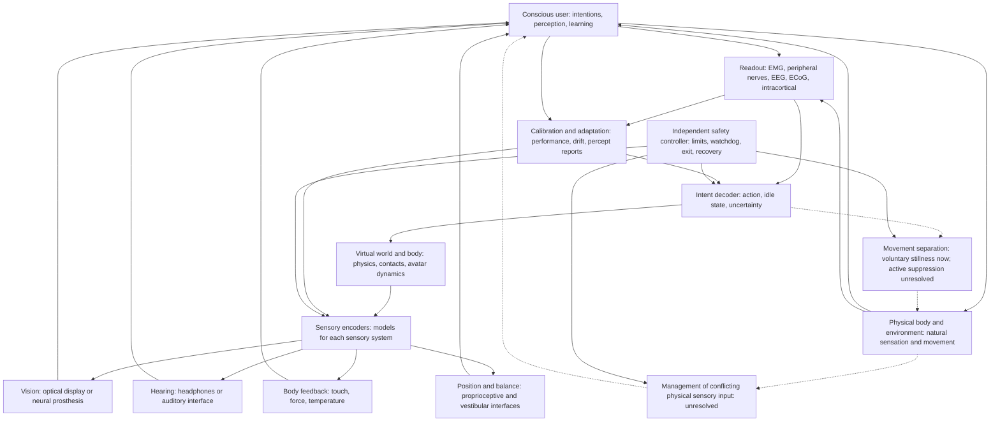

# Full-dive VR systems architecture

This is a requirements diagram, not a claim that the integrated system exists. Solid arrows describe ordinary information flows. Dashed arrows identify unresolved management of physical movement and conflicting physical sensory input.

## Readout and feedback form different paths

Readout estimates voluntary action. Feedback generates sensations that help the user control that action. A working decoder does not establish a working sensory encoder.

The physical body continues to supply sensory input. Writing a virtual limb-position signal does not necessarily remove the real limb-position signal. Preventing physical displacement does not remove muscle activation, effort, or afferent feedback.

## Start with the accessible path

The first project uses surface EMG, a virtual hand, and mechanical vibration. Ordinary vision and hearing remain available. The hand is supported and physical movement is measured. The project calls vibration-based force cues sensory substitution rather than natural touch restoration.

See the [feasibility study](feasibility-study.md) for evidence and the [first-project spec](../specs/001-stationary-virtual-hand.md) for proposed implementation requirements.
